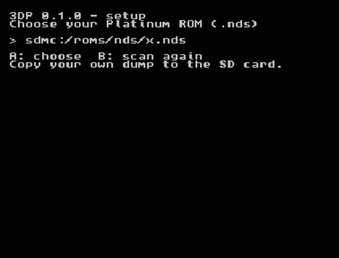

# 3DP

3DP is a native port of Pokémon Platinum to the New Nintendo 3DS. It is not an emulator: the game's
own code, built from the community decompilation, runs directly on the 3DS, with a thin layer of
our code under it that stands in for the DS hardware.

Two things make it different from playing the game on a DS:

- **Widescreen that shows more world.** The top screen is 400 wide instead of 256. The overworld
  camera uses the extra width to show more of the map. Nothing is stretched.
- **Real stereo 3D.** The overworld is true 3D geometry, so the 3DS 3D slider gives it real depth.

Version: **v0.1.0**. This is an early, rough release of the source. What changed and what comes next:
[RELEASE-NOTES.md](RELEASE-NOTES.md).

## What this repository contains

This repository contains no Nintendo or Game Freak code, art, text or audio beyond the function, type and
file names (and their declarations) that our changes have to match. The build applies our changes to the
pret decompilation you fetch yourself, and the game reads its data from a dump of your own cartridge.

The hardware layer is written from public hardware documentation (GBATEK) and documented reverse
engineering; the edits were written against the pret decompilation.

You bring two things: the pret decompilation (which you fetch and build yourself) and a dump of
your own Pokémon Platinum cartridge (today the US release; every region is planned). There are no downloads here: no ROM, no prebuilt `.cia`,
no release builds.

3DP is not affiliated with or endorsed by Nintendo, Game Freak, Creatures or The Pokémon Company.
Pokémon and all related names and trademarks belong to their owners.

## What works

Measured in Azahar (a desktop 3DS player we test with), on the build from this source:

- boot, then the title screen, then Continue;
- the overworld, in widescreen and in stereo 3D;
- the menus, drawn over the 3D world;
- save write-back (the game saves to the card image and the port writes it to your SD).

On a real New 3DS, one session so far: the 3D overworld works well, the menu sits on top of the
world, and touch works. (Touch was seen only there, not measured in Azahar.)

## Not tested, not done

Be warned: this is early. Here is everything we know is missing or unproven.

What the one real-hardware session showed, in the words of the person who ran it:

- "VERY VERY VERY VERY SLOW, took several minutes to be able to enter the game."
- "no sound at all."
- Inside the Pokémon Center the picture is flat, with no stereo. The party screen is flat too.
- The bottom screen uses only the small DS-sized area, not the whole 320x240.

Also:

- It is **one real-hardware session so far**. Nothing here is proven on hardware beyond those notes.
- It does not run at 60 fps yet.
- There are known pixel gaps against the real game's picture ("Every pixel" in the plans below).
- The real-time clock, sleep and the microphone are not done ("System" below).
- The Underground, contests, the Battle Frontier and Pal Park are not done ("Every mode" below).
- Wide versions of the 2D effects (weather, cave darkness and so on) are not done ("Wide and deep" below).
- Battles and the full story are untested.
- It is not made for the Old 3DS yet; that is planned (below). Today's target is the New 3DS and New 2DS XL.
- Only the US release of Platinum is accepted today; every region is planned (below).
- The `.3dsx` cannot claim the second CPU core; use the `.cia`.
- Local wireless, Wi-Fi and the GBA slot are not done; all three are planned (below). Platinum has no Download Play, so there is none to port.
- **Keep a backup of your save.** The port writes its own copy of your save in `sdmc:/3ds/3DP/`. Copy your save somewhere safe first.

## Plans

In plain words, in the order we want to work:

1. **Speed first.** Get into the game much faster than today, then aim for a steady 60 fps.
2. **Sound.** Music, cries and menu sounds.
3. **Every pixel.** Close the remaining differences between our picture and the real game's.
4. **System.** Clock and day/night, sleep, microphone, and better use of the bottom screen.
5. **Every mode.** Battles, the Pokétch, the Underground, contests, the Battle Frontier, Pal Park.
   - **Local wireless:** the Union Room, trades and battles between two consoles running 3DP.
   - **Wi-Fi:** the GTS, Wi-Fi trades and battles through a community server that still serves Platinum,
     if its operators agree and our legal check passes.
   - **The GBA slot:** a tab on the bottom screen to "insert" a dump of your own GBA cartridge and its
     save, so Pal Park and the GBA-slot encounters work.
6. **Wide and deep.** Widescreen and stereo for the 2D effects, interiors and menus too.
7. **Every region.** Platinum from every region, not only the US release.
8. **Old 3DS.** Running on the original 3DS and 2DS too.

## Build and use

Building is described in [BUILDING.md](BUILDING.md). In short: fetch and build the pret
decompilation, run `tools/get_pret.sh` (it fetches pret at the right commit), then `tools/sync_port.sh`
(it copies pret's tree into `port/` and applies our changes), then `make` (a `.3dsx`) or `make cia`
(an installable `.cia`).

- **Install the `.cia`.** The `.3dsx` from the Homebrew Launcher cannot reliably claim the second
  core, which the port needs. The `.cia` is the real target.
- **Target:** New 3DS and New 2DS XL. Old 3DS is best effort.
- **Files live in `sdmc:/3ds/3DP/`** on the SD card: the config, the logs and your save.
- **First launch.** If no game is set up yet, a setup screen opens. Pick your game file (a dump of
  your own Pokémon Platinum cartridge; today the US release), then import an existing save or start a new one. Your
  original save file is only read, never written. Holding SELECT at launch opens the setup screen
  again.
- **Turn on widescreen and 3D.** In this release they are off by default, so the game starts in the DS
  layout. After the first launch, add two lines at the top of `sdmc:/3ds/3DP/config.ini`, `wide = 1` and
  `stereo = 1`, then start 3DP again and use the 3D slider.

## Your game file

3DP needs a dump of your own Pokémon Platinum cartridge: a `.nds` file made from a cartridge you
own. Dump your own cartridge; 3DP does not include a game file, does not download one and has no
dumper built in.

The setup screen checks the file you pick and refuses anything that is not Pokémon Platinum (US). Other regions are planned.

## Sharing

Please don't share builds; everyone builds their own. This is a request, not a licence term.

## Legal

- 3DP is a fan project. It is not affiliated with or endorsed by Nintendo, Game Freak, Creatures or
  The Pokémon Company. Pokémon and all related names and trademarks belong to their owners.
- No ROM, no game data and no builds are distributed here; see "What this repository contains" above.
- The software comes with no warranty (GPLv3, sections 15 and 16). You use it at your own risk,
  including the risk to your save.

## Licence

The files in this repository are under the GNU General Public License v3 (see [LICENSE](LICENSE)).
That covers only the files in this repository. It does not cover the pret decompilation or
anything in it, and it does not cover your dump.

## Credits

- [pret](https://github.com/pret/pokeplatinum), whose Pokémon Platinum decompilation this builds on.
- GBATEK (Martin Korth), the public DS hardware documentation the hardware layer is written from.
- [devkitPro](https://devkitpro.org/), libctru, citro2d and citro3d, the 3DS toolchain and libraries.
- makerom (Project_CTR) and bannertool, which package the `.cia`.

Enjoy :)
